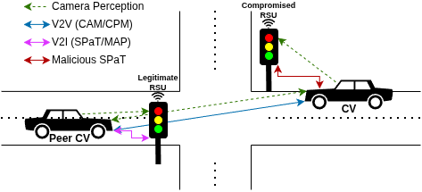
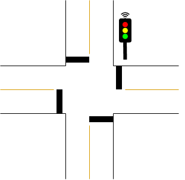
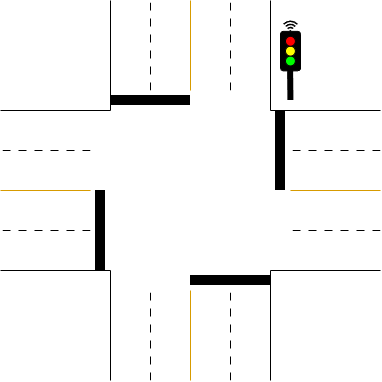
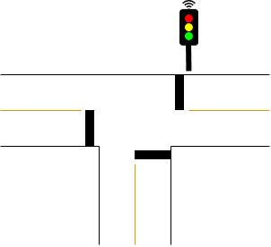
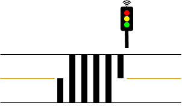
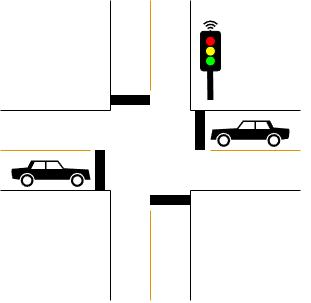
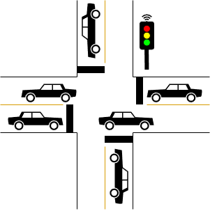
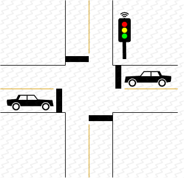
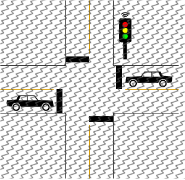

# SPADE

SPaT Attack Detection and Evaluation dataset
 

---

## SPADE Threat Model: Attack Classes, Targeted SAE J2735 Fields, and Observable Multi-Modal Signatures
 
| Class | J2735 Field(s) | Observable Signature |
|---|---|---|
| **BENIGN** | N/A | All streams consistent; camera–SPaT agreement holds |
| **FALSE_STATE** | MovementPhaseState | Reported phase contradicts camera detection |
| **REPLAY** | Full SPaT msg | Stale phase/timer; timestamp inconsistent with clock |
| **TIMING_MANIP** | MinEndTime, MaxEndTime | Phase matches camera; countdown deviates from elapsed time |
| **SYBIL** | Source ID, V2V msg | Peer consensus fails; conflicting phase perception reports |
| **DOS** | N/A (suppression) | Inter-message interval exceeds expected broadcast period |
| **IMPERSONATION** | IntersectionID, source address | Source mismatch with known RSU identity |
 
*Note: DoS is modeled as application-layer message suppression, observable as the absence of SPaT broadcasts within the expected reception window.*
 
---
 
## SPADE Feature Set: SPADE Data Records (40)
 
### Vehicle Data Record (11)
 
| Feature | Description |
|---|---|
| vehicle_id | ID of the current vehicle |
| route_id | Route which the vehicle is traveling |
| lane_id | Current lane index of the vehicle |
| is_parked | Is the vehicle currently in a parked state |
| position | Latitude and longitude of the vehicle |
| heading | Vehicle's current heading |
| speed | Current vehicle speed |
| throttle | Amount of throttle applied |
| brake | Amount of brake applied |
| longitudinal_accel | Amount of longitudinal acceleration |
| slope | Current slope the vehicle is on |
 
### CAM Data Record (5)
 
| Feature | Description |
|---|---|
| vehicle_id | ID of the transmitting vehicle |
| message_time | Time the message was sent |
| position | Current transmitting vehicle position |
| distance | Distance between vehicles |
| vehicle_awareness | Transmitting vehicle proprioceptive data points |
 
### TL Perception Data Record (10)
 
| Feature | Description |
|---|---|
| signal_id | ID of the perceived traffic signal |
| incoming_lane | Lane which precedes the signal |
| distance | Distance from current vehicle to signal |
| angle_off_center | Angle off center of camera |
| signal_red | Red one hot |
| signal_yellow | Yellow one hot |
| signal_green | Green one hot |
| camera_conf | Perception confidence level |
| cur_vis_score | Current visibility score |
| conf_vis_weighted¹ | Confidence level weighted with visibility |
 
### Shared TL Perception Data Record (3)
 
| Feature | Description |
|---|---|
| vehicle_id | ID of the transmitting vehicle |
| vehicle_pos | Position of the transmitting vehicle |
| signal_perceptions | List of perceived signals (TL Percep. records) |
 
### MAP Data Record (6)
 
| Feature | Description |
|---|---|
| message_time | Time the message was sent |
| intersection_id | ID of the intersection |
| lane_id | The intersection lane being referenced |
| lane_attributes | Lane properties (direction, type, shared) |
| lane_connections | Connected lanes (ex. u-turn, left, straight) |
| position | Latitude and longitude of the intersection |
 
### SPaT Data Record (5)
 
| Feature | Description |
|---|---|
| signal_id | ID of this individual signal |
| message_time | Time the message was sent |
| signal_state | Current signal state |
| max_end_time | Maximum length of the current state |
| min_end_time | Minimum length of the current state |
 
¹ `conf_vis_weighted = camera_conf × cur_vis_score`

---

## Scenario Configurations

<table align="center">
  <tr>
    <td align="center" width="25%">
       
      (a) <code>2-LANE</code>
    </td>
    <td align="center" width="25%">
       
      (b) <code>4-LANE</code>
    </td>
    <td align="center" width="25%">
       
      (c) <code>T-CROSS</code>
    </td>
    <td align="center" width="25%">
       
      (d) <code>PXO</code>
    </td>
  </tr>
  <tr>
    <td align="center" width="25%">
       
      (e) <code>LOW-DEN</code>
    </td>
    <td align="center" width="25%">
       
      (f) <code>HIGH-DEN</code>
    </td>
    <td align="center" width="25%">
       
      (g) <code>HIGH-VIS</code>
    </td>
    <td align="center" width="25%">
       
      (h) <code>LOW-VIS</code>
    </td>
  </tr>
</table>
<em>The eight simulation scenario configuration types shown for SPADE. Note that there is a traffic signal for every stop line, however only one is shown in each configuration example. Row 1 (3a–3d): intersection and mid-block crossing geometry types derived from OSM exports. Row 2 (3e–3h): representative extremes of the two operating condition dimensions — traffic density (LOW-DEN and HIGH-DEN) and camera visibility (clear HIGH-VIS and heavily degraded LOW-VIS). The full configuration matrix also includes MED-DEN and MED-VIS as intermediate levels: 4 × 3 × 3 = 36 base configurations, each repeated with five random seeds, yielding 180 unique scenario runs.</em>
